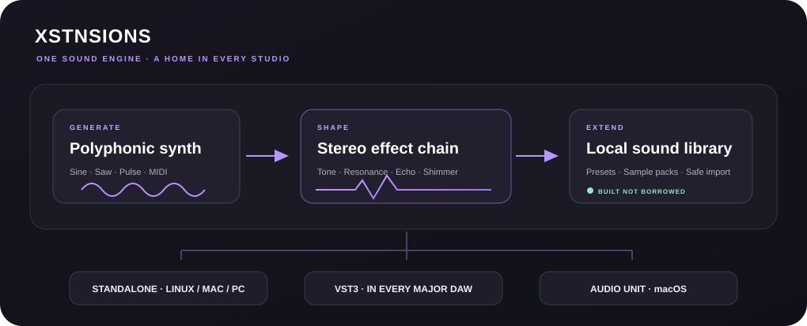

# XSTNSIONS

**A modular instrument and effect for the studio you already use.** XSTNSIONS is an early-stage native audio plug-in with matching standalone builds, a small built-in synthesizer, a stereo effect chain, and a local extension library.



## What is in this MVP

- **Instrument:** sine, saw and pulse synth voices with MIDI note input, velocity, release and 32-note polyphony.
- **Effect:** stereo audio input, tone/resonance, shimmer/chorus and echo. The same effects work with or without the built-in synth.
- **DAW integration:** separate instrument and effect products, exported as **VST3** on Linux/macOS/Windows and **AU** on macOS. JUCE provides its built-in **Standalone** format on all desktop targets.
- **Host automation:** volume, tone, resonance, echo, shimmer and oscillator controls are saved in the host's session.
- **Extensions:** bundled Aurora Keys and Velvet Pulse example manifests, plus user-managed local imports of presets and sample-pack folders.
- **Native third-party formats:** `native-plugin` is recognized as package metadata, but executing another vendor's VST/AU/AAX/CLAP plug-in is deliberately not enabled in this MVP. Imported binaries are never executed.

The **cloud music-production version**, plugin hosting, GitHub/cloud/magnet import, and AAX/CLAP output are not part of this desktop MVP.

## Build

### Prerequisites

- CMake 3.22+
- A C++17 compiler
- Git (CMake FetchContent downloads JUCE 9.0.4 the first time)
- **Linux:** X11, Xinerama, Xrandr, Xcursor, Xext, OpenGL, ALSA and FreeType development packages.
- **macOS:** Xcode command-line tools; AU is built only on macOS.
- **Windows:** Visual Studio 2022 C++ desktop tools.

The portable DSP and extension-import regression tests intentionally have no JUCE, audio device, or desktop-window requirements. Run them first:

```sh
cmake -S . -B build -DBUILD_TESTING=ON -DCMAKE_BUILD_TYPE=Release
cmake --build build --target xstnsions_engine_tests -j2
ctest --test-dir build --output-on-failure
```

Then build both plugins and standalone applications:

```sh
cmake --build build --config Release -j2
```

Install via the generated CMake install step if packaging/install rules are added; until then, copy the standalone apps and generated `.vst3` / `.component` bundles to the standard directories of your DAW/OS and rescan plugins. In a DAW, add the **instrument** to a MIDI/instrument track; insert the **effect** on an audio channel. Standalone instruments need a MIDI input selected, and standalone effects need a live audio input.

> JUCE is fetched from its upstream Git repository under the JUCE license. Read the official JUCE license and JUCE's VST3/AU/AAX SDK terms before distributing generated plug-ins.

## Local extension format

Each package is an ordinary folder containing an `extension.json` manifest and optional preset/data files:

```text
Aurora-Keys/
├── extension.json
└── Presets/
    └── warm.json
```

Example:

```json
{
  "schemaVersion": 1,
  "id": "aurora-keys",
  "name": "Aurora Keys",
  "version": "1.0.0",
  "kind": "preset",
  "author": "Example",
  "description": "A warm, soft keys patch.",
  "preset": {
    "waveform": "sine",
    "volume": 0.72,
    "cutoff": 0.61,
    "resonance": 0.11,
    "delay": 0.24,
    "chorus": 0.33
  }
}
```

The importer opens one local folder, validates the manifest, rejects duplicate/path-traversal IDs and symbolic links, limits imports to 512 MiB / 20,000 files, and installs a copy atomically in the per-user library under `XSTNSIONS/Extensions`. Choose preset or sample-pack folders; `native-plugin` is a reserved metadata kind, **not a way to load or execute plugin binaries**. Existing extensions are never overwritten. The starter preset manifests are in [`extensions/aurora-keys`](extensions/aurora-keys/extension.json) and [`extensions/velvet-pulse`](extensions/velvet-pulse/extension.json).

## Project layout

- [`Source/AudioEngine.h`](Source/AudioEngine.h): dependency-free wavetable instrument, effects and extension-manifest parser.
- [`Source/ExtensionManager.h`](Source/ExtensionManager.h): bounded, symlink-resistant folder import and library discovery.
- [`Source/PluginProcessor.cpp`](Source/PluginProcessor.cpp): JUCE processor, MIDI routing, host automation and preset/state serialization.
- [`Source/PluginEditor.cpp`](Source/PluginEditor.cpp): standalone/DAW interface, effects controls and package importer.
- [`Tests/AudioEngineTests.cpp`](Tests/AudioEngineTests.cpp): audio, MIDI and extension-install regression tests.

## Platform and format scope

A single source tree builds VST3 plus JUCE Standalone for **Linux, macOS and Windows 10/11**. Audio Unit is macOS-only. AAX needs Avid's SDK and separate authorization/licensing. CLAP is neither built in nor hosted. A future web edition cannot run arbitrary native desktop plugin binaries directly.
